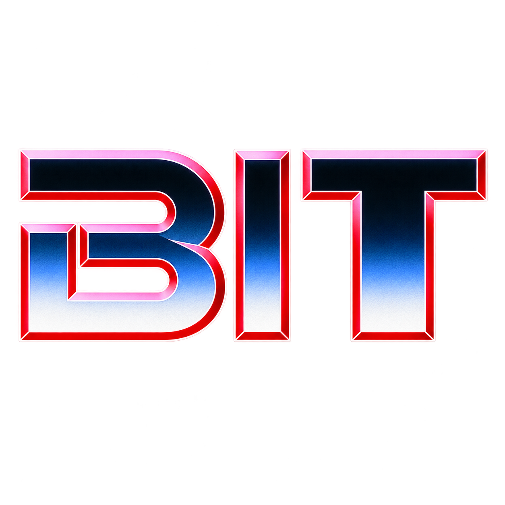

<p align="center">
  
</p>

<p align="center">
  <a href="https://github.com/nomoreimfull/bit-android/raw/refs/heads/main/dist/Bit-v1.6-debug.apk">Download APK (v1.6)</a>
</p>

# Bit for Android

A native Kotlin/OpenGL ES port of **Bit 1.0.0.2**, © 2005 Anders Hovmöller, SK Soft. Recovered geometry, animation constants, original PRNG and original audio; no web runtime, speech synthesis, network access, boot receiver or wake lock.

## Edge extension (Android port 1.2)

Use **Settings → Geometry → Edge extension**. Start around **25%**, then drag Bit toward an edge. **0%** keeps its entire square window inside; **50%** lets its center reach an edge so part of the object can sit off-screen. Increasing the value expands where you can drag; reducing it brings Bit inward immediately. Larger responses may be clipped. Reset position restores a visible default. The setting and partial off-screen position survive restarts and rotation.

[Chat-bubble research and implementation details](CHAT_BUBBLES.md) explain how Android allows collapsed bubbles to overhang their side bounds and how Bit adapts that behavior using its existing small overlay.

## Visual theme (Android port 1.1)

The user-supplied BIT artwork is shown unchanged, aspect-fit on black for a brief launcher splash, then settings opens. Android 12+ also uses the artwork for the system starting screen. Settings uses a black background, graphite panels, cyan circuit-style outlines, red audio accents and monospace labels inspired by Tron (1982). Returning from permissions or notification settings does not replay the custom splash. The recovered floating object and original response sounds retain their original appearance and behavior.

## Install

The committed v1.2 APK is `dist/Bit-v1.2-debug.apk`, with its SHA-256 file alongside it. Fresh local builds produce `build/Bit-debug.apk`.

Install either APK on Android 8.0 (API 26) or newer. It contains platform-independent bytecode and assets, so supports ARM and x86 devices. Android 11+ provides the most accurate system bar/cutout bounds.

```sh
adb install -r build/Bit-debug.apk
adb shell am start -n org.sksoft.bit/.SettingsActivity
```

Or open the APK on your phone and allow your file manager to install apps when Android asks. Open **Bit** from the launcher. Enable floating Bit, grant **Display over other apps**, and return to Bit. Allow notifications for the persistent Open settings / Stop Bit controls.

Tap the object for a response; drag to move it. Use settings for size, playback gain, previews and reset position. Closing settings leaves an enabled overlay running. Stopping Bit or force-stopping the app ends it. After Android kills the process, reopen settings and enable Bit again. No automatic boot start is installed.

The overlay uses a small, translucent `TYPE_APPLICATION_OVERLAY` window. Outside that window, touches go to the underlying app. The invisible corners **inside the small square touch window** still belong to Bit. Maximum window size is 280dp or the current usable screen, whichever is smaller; minimum is 56dp. Only the geometry is painted. The object’s silhouette is smaller than its window and varies while it breathes. The optional Edge extension setting permits partial off-screen placement; default 0 retains full-window clamping.

## Build

The complete project is in `app/`, with a Gradle wrapper and a framework-only direct build. The supplied APK was built with the direct build on ARM64 Termux, Java 21, Android platform 36, Kotlin 2.3.10 and native AAPT2/D8/apksigner. The standard Gradle configuration is supplied for desktop Android Studio; that build route was not exercised here.

### Android Studio / standard SDK

Install JDK 17 or newer, Android SDK platform 36 and build tools 36.0.0. Set `ANDROID_HOME` (or put `sdk.dir=/your/android-sdk` in `local.properties`). Gradle 9.4.1 downloads via the wrapper; Android Gradle Plugin 9.2.1 includes Kotlin support.

```sh
sh gradlew :app:assembleDebug
adb install -r app/build/outputs/apk/debug/app-debug.apk
```

### Direct build (the verified route)

Requires Python 3, JDK 17+, `aapt2` (or `aapt2-aosp`), `d8`, `apksigner`, and a Kotlin compiler distribution. Put Android SDK build-tools on `PATH`. Set the Kotlin **distribution** root, whose `lib/` includes compiler and standard-library JARs. No Python packages or asset extraction tools are needed for ordinary builds.

```sh
export ANDROID_JAR="$ANDROID_HOME/platforms/android-36/android.jar"
export BIT_KOTLIN_HOME=/path/to/kotlinc
sh build.sh
python3 tools/check.py
```

In this workspace `build.py` also detects the existing Kotlin 2.3.10 Gradle cache when `BIT_KOTLIN_HOME` is unset. The default SDK path is `~/android-sdk/platforms/android-36/android.jar`. Termux requires native ARM build tools; Google's desktop Linux binaries are x86-64.

Output: `build/Bit-debug.apk`, signature-verified, with `build/Bit-debug.apk.sha256`. The local debug signing key is generated in `build/debug.keystore`; retain it if you want subsequent APKs to update an existing installation. These commands do not modify the system volume or install the app automatically.

## Verification and provenance

- [Reverse-engineering report](REVERSE_ENGINEERING.md): offsets, geometry, lighting, timing, sounds, extraction and deliberate differences.
- [Test record and device checklist](TESTING.md): completed host checks and unexecuted device checks.
- `analysis/disassembly.txt`, `analysis/pe.txt`, `analysis/recovered.json`, `analysis/timer-probe.json`, `analysis/meshes.json`: inspection evidence.
- `tools/recover.py`: resource extraction and isolated CPU emulation of display-list construction.
- `tools/probe_timer.py`: executes both original timer branches and PRNG with all external calls intercepted.
- `tools/decode_audio.py`: original MP3 → uncompressed PCM conversion using libmpg123.
- `tools/check.py`, `tests/ModelChecks.kt`: repeatable asset, timer parity, PRNG and placement checks.

The EXE was never launched as a Windows application. Only selected x86 routines were CPU-emulated with Unicorn, with every imported API intercepted; no host Windows API, EXE-provided filesystem operation or network operation was allowed.

## Android limits

The service uses `specialUse` with a declared subtype for the user-enabled companion overlay. It starts only from the visible settings activity following a user action. Android 14+ requires a foreground service type and matching permission; see [official foreground service types](https://developer.android.com/develop/background-work/services/fgs/service-types). A Play Store release would need its applicable special-use declaration/review.

Android may hide overlays over permission dialogs, secure apps, protected system UI and lock screens. This app also pauses/hides Bit while the screen is off or locked. No mechanism bypasses these protections. Foreground-service status improves continuity but does not guarantee process survival. If notification permission is denied, Android can show the service only in Active apps / Task Manager instead of the notification drawer; see [notification permission and foreground services](https://developer.android.com/develop/ui/views/notifications/notification-permission).

Audio uses transient audio focus, media routing and app-local gain. Playback stops on focus loss. On recent Android versions an app requesting focus must be foreground or running a foreground service, both true for the supported playback paths; see [official audio focus guidance](https://developer.android.com/media/optimize/audio-focus).

## Attribution

Original application and extracted sounds/geometry: **Bit, version 1.0.0.2, © 2005 Anders Hovmöller, SK Soft**. The EXE’s embedded URL is `http://soft.killingar.net` (historical attribution only). The sound resources additionally credit **Tron, Walt Disney Pictures**, with source metadata **SciFlicks.com**. The Android launcher icon is a new vector illustration. No license for redistribution of the original assets was present in the EXE; attribution does not grant additional rights. The source and extraction record are provided for this requested port; no claim of original-asset ownership is made.
